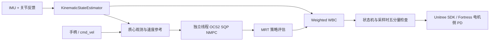

# custom_dog_control

ROS 2 Humble 四足 NMPC＋WBC 控制包，仿真和真机共用一个控制器。精准落足运行时及对应 ROS 消息/动作模块已移除；本包不加载 RL 策略。

完整 15.15 kg 模型位于同一工作区 [custom_dog_description](../custom_dog_description/README.md)，包含全部 URDF 与实体网格。构建和运行入口使用本地安装模型，并核对源/安装 URDF 一致，不再依赖相邻 RL 目录或旧 `external/model_ws`。

| 入口 | 用途 |
| --- | --- |
| `custom_dog_control/NmpcWbcController` | 控制器插件 |
| `custom_dog_control/UnitreeSystemInterface` | 真机硬件插件 |
| `config/controllers.yaml` | 真机/Fortress 公共频率、增益、步态与速度限制 |
| `config/real_controller.yaml` | 仅真机时钟、硬件和启动差异 |
| `config/nmpc/task.info` | NMPC 代价、约束和 WBC 参数 |
| 公共频率目标 | 主循环 250 Hz，NMPC 20 Hz，求解线程 2 |
| `scripts/build_real.sh` / `scripts/run_real.sh` | 真机构建与启动；构建不会打开电机 |
| `scripts/run_dog.sh` | 无 YES 交互的桌面入口，释放本工具监视占用，启用单次预对位与真机 RViz |
| `scripts/run_fortress.sh` | ARM64 电机侧 PD 物理仿真，使用公共参数、关闭真值反馈 |

## 算法链路



NMPC 状态为 24 维（归一化质心动量、基座位姿和关节位置），输入为 24 维（四足力和关节速度）。WBC 使用全身动力学、力矩限位、摩擦锥与接触约束，输出前馈关节力矩。关节目标来自 NMPC，WBC 加速度解不被积分为关节目标。

接触相位来自计划步态，机器人没有足底接触传感器。真实状态估计使用 IMU 与关节运动学；Gazebo 可以显式选择仿真真值。15.15 kg 模型在原 1000 Hz 配置下确已通过关闭真值辅助的平地低速物理测试，见 [历史记录](../../docs/simulation-validation-20261102.md)。**恢复启动辅助之前，250 Hz 电机侧 PD 的完整低速物理回归及 60 秒站立本轮已通过**：关闭真值辅助，使用旧手柄 START/组合键完成起身、前进/停车/恢复、后退、左右横移、双向转向，未进入 FAULT。后续新增硬件启动辅助、真实 START 等待及可视化，算法配置未改，构建指纹已更新；旧回归不覆盖这些新增功能。结果见 [兼容验收记录](../../docs/compatibility-validation-20261103.md)；真机运动仍未验收。

并发 colcon 编译时曾触发策略超时，独立重跑通过且超时门限未放宽；本轮通过结果不保证任意并发负载下的实时性。

当前输出保持 `q_des、dq_des、tau_ff、kp、kd` 五分量，真机由电机侧计算 `tau_ff + kp*(q_des-q) + kd*(dq_des-dq)`。发送前按当前反馈计算各项绝对值贡献之和 `abs(tau_ff)+kp*abs(q_des-q)+kd*abs(dq_des-dq)`，必要时共同缩放该关节前馈与两个增益，保留位置/速度目标。它只保证当前采样时的贡献上界，不能声明采样之间连续实际力矩始终小于 URDF effort 限制。

真机与 Fortress 从 `controllers.yaml` 共用 250 Hz/20 Hz、2 求解线程、髋/大腿起身 Kp 45→55、小腿60→80、Kd 1.5→2.5；WBC 的髋/大腿/小腿 Kp 分别50/20/40、Kd2。小腿通过 `wbc_calf_stiffness` 独立配置，省略或设为-1时继承大腿值。共享速度限制为前后/侧向各0.05 m/s、偏航0.2 rad/s。最新增益的验证范围见 [真机说明](../../docs/hardware.md)。当前 Fortress 模型在每个 1 ms 物理步执行电机侧 PD，保留外环一周期及物理步相位延迟；它是理想伺服模型，不是真实电机带宽、时延或连续力矩饱和的测量。以前的 250 Hz 主机 PD 纯力矩实验是另一种时序，保留在 [历史链路记录](../../docs/real-control-validation-20261102.md)，不作为当前架构的验收结论。

启动辅助恢复前的实际运行参数对照确认同一编译控制核心、规范 URDF 与 NMPC task/reference；当时 73 项参数中 64 项相同，差异仅是时钟、IO 插件和仿真专用项，controller_manager 两路均为 250 Hz。该参数计数及指纹属于当时版本，完整差异见 [兼容验收记录](../../docs/compatibility-validation-20261103.md)。

## 真机状态流程

```text
若启用启动辅助：PASSIVE -- 12路反馈/接管/心跳有效 --> 单次预对位/释放完成
PASSIVE -- START --> CALIBRATION -- 完成 --> PASSIVE
PASSIVE -- LT+A，标定有效 --> STAND_UP --> MPC_STANCE
MPC_STANCE -- LT+X + 有效速度 + 新策略 --> MPC_TROT
MPC_TROT -- 停车并收到新站立策略 --> MPC_STANCE
故障/LT+Y --> FAULT -- LT+B --> PASSIVE（需重新标定）
```

真机通过 `legacy_joy_layout=true` 恢复旧 `qr_ws` 输入布局，LT 即旧 L2；单按 A/X 不切换模式。若启用启动辅助，完成后需重新按 START；辅助期间的提前按下或持续按住不会自动完成采零。START 只声明当前机械参考姿态并采集零点，不发起起身。旧标定公式在 URDF 坐标变换后等价，细节见 [兼容验收记录](../../docs/compatibility-validation-20261103.md)。标定后重置估计器和异步求解器中的旧观测/策略；未标定的原始编码器不能初始化站立估计。LT+X 不能从被动状态直接起身。

左摇杆前后控制前后，右摇杆左右控制侧移，左摇杆左右控制转向；三轴保留 0.08 死区，在 REP-103 中为 `vx=-LY、vy=-RX、yaw=-LX`。LT+Y 现为软件急停，替代已移除的旧 STEP_TEST。默认现代仿真/键盘布局保持；在 Fortress 加 `legacy_joy_layout:=true` 可复现同一旧手柄流程。

LT+X 只使能行走，摇杆回中保持站立，不原地踏步；起身过程中按下不会排队，需在站立模式再按。真实启动默认将约 10 Hz 控制诊断保存到本次 ROS 日志目录的 `control-diagnostics.jsonl`，包含全 12 关节反馈、起身目标、控制器五分量请求与手柄门限状态。请求值不是最终电机报文，effort 反馈也未完成物理标定。每段最多 16 MiB，保留初始段及最近三个分段；可用 `record_diagnostics:=false` 关闭。终端会显示模式与行走使能变化。最新后部起身困难和右后髋通信故障的证据见 [真机排查](../../docs/hardware.md)。

初次起身稳定后向 WBC 平滑交接；Trot 停车后不重复起身插值。安全故障覆盖正常输出，故障锁存只能通过 LT+B 确认复位。桌面 `run_dog.sh` 不要求输入 YES，启动前自动停止本工具身份匹配的 mode 0 通信监视进程以释放串口，随后直接调用真机入口；`--help`/`--show-args` 不停止监视。

桌面指定 `require_physical_estop_confirmation:=false`、`startup_alignment_enabled:=true`、`use_rviz:=true`，不自动声明 `physical_estop_verified=true`；直接 `run_real.sh` 默认仍要求原确认条件，并默认关闭辅助和 RViz。

旧 IOSDK 的启动小力矩预对位曾在移植时遗漏，现恢复为独立非阻塞、单次辅助。它在 12 路反馈有效、控制器完整接管且持续写入后自动开始，保持旧版转子方向；关节侧幅值 hip/thigh/calf 为 `0.95/0.63/1.52 N·m`。先 hip/thigh 300 ms，再三关节 300 ms，最后 mode0 释放 300 ms。控制器可仍显示 PASSIVE，但辅助阶段会发送非零力矩；不能再宣称所有 PASSIVE 都恒为 mode0。通信/CRC 失败、软件急停、写入心跳过期、撤销接管或过程中的标定复位会退零中止，不自动重试，需要重启恢复。任一电机反馈不完整或陈旧时不会满足开始条件。

恢复后的 profile 已经 PTY 验证；本次通信探针没有发送该非零辅助，真实辅助执行仍未验收。用户期间自行启动过控制程序，不把这次通信复测作为真实启动流程验收。恢复启动流程和通信不能证明机械零位、正方向、物理急停、承重起身或行走已验收。

真机 RViz 固定坐标系为 `base`，RobotModel 来自关节反馈、足端 TF 来自 FK。标定前原始编码器角未对齐 URDF 零位，不能把显示姿态视作已完成机械标定；足端 TF 不代表实测足底力。

## 实现入口

| 文件 | 职责 |
| --- | --- |
| `src/controller/NmpcWbcController.cpp` | 主周期、估计、策略评估、安全检查 |
| `src/controller/ControllerLifecycle.cpp` | 参数、模型、线程和 ROS 生命周期 |
| `src/controller/ControllerStateMachine.cpp` | 标定、起身、站立、Trot 与交接 |
| `src/controller/ControllerHardware.cpp` | ros2_control 状态读取和命令输出 |
| `src/controller/ControllerInputs.cpp` | 手柄和速度输入 |
| `src/nmpc/NmpcBackend.cpp` | NMPC 线程、参考、WBC 与策略重置 |
| `src/nmpc/ModelCache.cpp` | 按模型/配置/架构内容区分 CppAD 缓存 |
| `src/hardware/IOSDK.cpp` | 四路 RS485 电机通信 |
| `src/hardware/UnitreeSystemInterface.cpp` | 硬件接口、标定请求和输出检查 |
| `include/.../control/JointCommandUtils.hpp` | 五分量采样边界检查与交接计算 |
| `include/.../control/JoystickMapping.hpp` | 旧手柄组合键、三轴与现代布局 |
| `src/hardware/FortressMotorSystem.cpp` | 五分量管线延迟及每物理步 PD |

上游 `LeggedInterface` 和 `WeightedWbc` 固定版本参与构建，来源哈希测试保留。公共 `RobotModel`、静力支持检查和 15.15 kg 质量契约保留。

既有数据的设备微秒时间戳确认 IMU/AHRS 各约 100 Hz，驱动没有固定 100 Hz 限频；ROS header 当前使用主机发布时间戳。用户之后自行配置设备输出率，本轮不修改 IMU 设置。

11 月 3 日 mode0 全零复测中，四腿 12 个电机各 500/500，合计 6000/6000，CRC/ID/模式/电机错误均为 0，FR 反馈已恢复。四路同时以每 ID 100 Hz 轮询约 5 秒，合计 6677/6678；结束快照记录 FR ID 2 一次未收齐回包/超时，原因未定位，不能称为全程零丢包或 250 Hz 周期验收。首次 IMU 捕获有一条较早 AHRS 时间戳；仅清主机 RX 队列后复测，IMU/AHRS 各 500 帧、设备时间戳均为 100 Hz，CRC 为 0，原异常未复现但来源未确证。所有探针已停并释放串口。证据在 [通信复测目录](../../log/communication-recheck-20261103-2347/summary.json)。

早期 FL/RR/RL 各 100/100、FR 各 0/100，以及旧 SDK typed/raw 2/20 ms 未取得 FR 有效回复的记录保留，原原因未定位。原驱动已实际发布 Xbox 360 手柄输入。Run Dog/手柄流程恢复和最新通信成功不等于真实启动辅助、标定或承重运动已验收。详细证据和边界以 [工作区 README](../../README.md)、[硬件说明](../../docs/hardware.md) 和 [兼容验收记录](../../docs/compatibility-validation-20261103.md) 为准。测试运行：

```bash
source src/custom_dog_control/scripts/env.sh
colcon test --packages-select custom_dog_control --event-handlers console_direct+
colcon test-result --verbose
```
