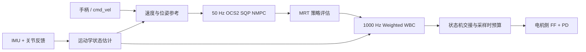

# custom_dog_control

[中文](#中文) | [English](#english)

## 中文

ROS 2 Humble 四足模型式 NMPC＋WBC 控制包。真机与 Gazebo 复用控制核心，分别连接 Unitree SDK 和仿真硬件接口。当前维护基础速度控制，不加载 RL 策略；精准落足及 `qr_*` 运行时已移除。开发与合并目标为 `RC2027`。

15.15 kg 完整模型由同一工作区的 [custom_dog_description](../custom_dog_description/README.md) 提供。入口检查源与安装 URDF 一致，不依赖相邻 RL 工程或旧 `external/model_ws`。工作区依赖安装见[总 README](../../README.md)，真机状态与证据见[硬件说明](../../docs/hardware.md)。

### 当前公共配置

参数以 [controllers.yaml](config/controllers.yaml)、[task.info](config/nmpc/task.info) 和 [Fortress 启动文件](launch/fortress.launch.py) 为准；下表核对于 2026-11-16。频率是配置目标，桌面仿真不证明板载实时期限。

| 项目 | 默认值与含义 |
| --- | --- |
| 主控／状态估计／WBC | 1000 Hz |
| NMPC | 50 Hz，运行时求解线程数 2，预测时域 1.0 s |
| Trot | 完整周期 0.40 s，每组对角腿摆动约 0.20 s，无四足支撑重叠 |
| 摆足 | 规划抬脚高度 0.10 m，不等同于实测足底净空 |
| 站姿 | 地面到 `base` 原点 0.34 m；名义髋角 0 rad，左右足心间距约 0.2787 m |
| 起身／起身稳定／MPC_STANCE／TROT 关节 PD | 髋／大腿／小腿 Kp **60／60／90**，Kd 均为 **2.0**；可能受预算缩放 |
| 公共速度限制 | 前后 0.05 m/s、侧向 0.05 m/s、偏航 0.20 rad/s |
| 速度变化率限制 | 平移 0.2 m/s²，偏航 1.0 rad/s² |
| 关节目标速度变化率限制 | 400 rad/s²；用于 WBC 和电机 `dq_des` |
| 名义高度加速度修正 | 上限 2 m/s²，不平移足端目标 |
| 横向参考位置误差记忆 | 上限 0.04 m，定义在估计坐标系，不保证真实横漂小于 4 cm |
| 球足滚动估计 | `estimator_rolling_foot_radius_m=0`，默认关闭 |
| 姿态前推 | `imu_orientation_prediction_max_s=0`，默认保持最新 AHRS 姿态 |
| 实验执行模式 | 延迟窗口预算、主机总力矩输出、名义关节参考、关节加速度耦合均默认关闭 |

起身目标包含模型静力补偿：`q_target=q_nominal+(g-Jᵀf)/Kp`，接触力用于平衡浮基座力／力矩。它是对 15.15 kg 模型的估计，不能用名义关节角直接替代。PASSIVE、CALIBRATION、FAULT 不使用上表主动阶段高增益保持。

NMPC 的主要 Q 对角项为：归一化线动量 100／20／100、角动量 10／30／30、位置 xyz 1000／1000／**2000**、欧拉姿态 yaw／pitch／roll 100／300／300；每条腿关节位置 20／5／2.5。`task.info` 的 R 模板整体缩放为 `1e-3`，12 个足端力项填 1，12 个关节速度项填 5000；不要将这些模板系数当作关节 PD 或直接的电机力矩惩罚。

| WBC 项目 | 默认值 |
| --- | --- |
| 摆足任务 PD | Kp 500，Kd 45 |
| 机身位置 PD，xyz | Kp 0／0／80，Kd 15／15／15 |
| 机身姿态 PD，yaw／pitch／roll | Kp 150／100／100，Kd 30／20／20 |
| 任务权重：摆足／机身／接触力／关节限位松弛 | 100／**1**／0.01／100 |
| 足地摩擦锥系数 | 0.5，与小腿传动摩擦是不同参数 |
| 关节名义力矩上限，髋／大腿／小腿 | 23.7／23.7／45 N·m |

WBC 权重先乘任务矩阵与右端，再形成平方代价；例如机身权重 1.5 对应平方系数 2.25。任务空间 PD 生成期望加速度，电机关节 PD 则作用于关节位置／速度误差，两者不是同一层反馈。

### 算法与执行边界



NMPC 状态为 24 维：归一化质心动量 6 维、基座位置与姿态 6 维、关节位置 12 维。输入为 24 维：四足力 12 维、关节速度 12 维。NMPC 在计划接触相位下优化质心运动与运动学轨迹，输出带时间的状态／输入策略，不直接输出电机力矩。

WBC 读入当前状态、NMPC 评估状态／输入和接触模式，用 qpOASES 解加权最小二乘 QP。物理决策量为广义加速度、四足力及 12 个关节前馈力矩，另有关节限位松弛量。约束包含全身动力学、力矩边界、支撑足零加速度、摆动足零接触力、足地摩擦锥及带松弛的预测关节限位；软任务跟踪摆足、机身加速度、接触力和限位松弛。

默认关节 `q_des` 来自 NMPC；`dq_des` 经变化率限制后同时送给 WBC 和电机 PD，WBC 的关节加速度解不被积分成关节目标。因而当前 **q/dq 尚不保证严格积分一致，跨策略也不保证 C1 连续**。

输出保留五分量 `q_des、dq_des、tau_ff、kp、kd`，电机侧请求为：

```text
tau_request = tau_ff + kp*(q_des-q) + kd*(dq_des-dq)
```

发送前以当前反馈检查 `abs(tau_ff)+kp*abs(q_des-q)+kd*abs(dq_des-dq)`；超出预算时同比缩小 FF、Kp、Kd，保留位置／速度目标。默认 WBC 约束前馈力矩，外部 PD 和延迟后的状态变化仍可能让执行时总请求越过名义上限。**采样时预算与未触发保护都不等于连续总力矩始终合规。**髋／大腿保护阈值为 26.07 N·m，小腿为 49.5 N·m，均为名义值的 1.1 倍，不是额定持续力矩。

`motor_pd_budget_horizon_s=0`、`motor_pd_nominal_execution_time_s=0`、`host_total_torque_command=false`、`wbc_nominal_joint_reference=false` 和 `wbc_use_joint_acceleration_decision=false` 保持默认。延迟窗口依赖尚未辨识的加速度包络，主机总力矩模式也未通过完整运动回归，不作为推荐方案。失败与限制见[执行预算／参考一致性记录](../../docs/validation/execution-budget-consistency-20261115.md)。

### Fortress 仿真与复现

已安装工作区及依赖后，在仓库根目录启动：

```bash
src/custom_dog_control/scripts/run_fortress.sh gui:=true
```

该入口只选择仿真插件，不启动串口、真实 IMU 或 Unitree 硬件插件。Fortress 不自动打开键盘节点；在另一个终端、相同 `ROS_DOMAIN_ID` 下运行：

```bash
source src/custom_dog_control/scripts/env.sh
ros2 run custom_dog_control keyboard_teleop.py --ros-args \
  -p max_speed_x:=0.05 -p max_speed_y:=0.05 -p max_speed_yaw:=0.2
```

默认现代布局：`3` 请求起身，完成后 `4` 使能 Trot；`W/S` 调前后、`A/D` 调侧向、`J/L` 调偏航，空格或 `X` 归零，`Esc` 软件急停。命令是增量保持，归零后保持 MPC_STANCE，不原地踏步。只运行一个命令来源；上述键盘示例对应默认 `legacy_joy_layout:=false`。

需要重新构建时，下面命令只构建仿真版本，完成后单独启动 Fortress：

```bash
CUSTOM_DOG_BUILD_ONLY=1 src/custom_dog_control/scripts/build_simulation.sh
```

`build_simulation.sh` 未设 `CUSTOM_DOG_BUILD_ONLY=1` 时会在构建后启动 Gazebo Classic；`run_simulation.sh`、`test_simulation.sh` 也走 Classic，不能把其结果标为 Fortress 电机侧 PD 结果。

更高速度使用独立 `controllers_file` profile，修改该文件的限速后传给 Fortress；`task_file` 可独立覆盖优化配置。公共限速仍为 0.05／0.05／0.2。运行速度扫描前，应确保测试与仿真位于同一专用 ROS domain，无键盘或其他测试同时发布命令。例如已运行合适限速的独立仿真后：

```bash
source src/custom_dog_control/scripts/env.sh
python3 src/custom_dog_control/scripts/simulation_speed_sweep_test.py \
  --axis x --direction positive --vx-levels 0.5,1.0 \
  --phase-duration 20 --soak-duration 30 --max-horizontal-speed 2.0 \
  --output log/forward-speed-sweep.json
```

该脚本会检查仿真时钟、仿真硬件诊断和独立真值，再自动请求仿真起身／运动；不能用于真机，也不会代为放开控制器限速。完整复现还应保留 profile、有效启动参数、task、模型／库指纹、记录器频率和脚本门限；上面的简短命令不等同于下面展示的完整验收配置。

### IMU、延迟和摩擦假设

Fortress 默认 `actuator_model:=motor_pd`，每个 1 ms 物理步根据当前关节反馈执行电机侧 PD；延迟的是整包五分量指令。

| 仿真参数 | 默认值 |
| --- | --- |
| `simulation_imu_rate_hz` | 100 Hz |
| `simulation_command_delay_s` | **额外 0.005 s**，原有外环一周期和物理步相位另计 |
| `simulation_coulomb_friction` | 髋／大腿／小腿 `0 0 0.45` N·m，四腿相同 |
| `simulation_viscous_friction` | `0 0 0.0175` N·m·s/rad，四腿相同 |
| `simulation_friction_velocity_scale` | 0.05 rad/s |
| `use_sim_ground_truth` | false；独立评估仍可读取真值 |

5 ms 和摩擦系数是仿真假设，**尚未通过真机辨识**。1000 Hz 外环的一周期约 1 ms，不能继续套用历史 500 Hz 的 2 ms。小腿附加 2:1 齿轮连杆，总减速比为 12.66；髋／大腿仍有电机内部 6.33 减速。摩擦输入已在关节输出侧，不重复乘减速比；髋／大腿附加摩擦设 0 不表示内部摩擦严格为零。

附加负载为 `-Fc*tanh(dq/0.05)-B*dq`，不包含静摩擦锁止、齿隙、正反向差异、连杆位置相关阻力或真实电流／热限制。摩擦参数接受 1 个统一值、3 个关节类型值或 12 个关节值；12 值顺序为 FR、FL、RR、RL，每腿依次髋、大腿、小腿。它们仅适用于 `motor_pd`。停机、安全输出、超时、无效反馈和时钟回退会清空延迟队列，旧包不会恢复后重放。

零额外延迟、零附加摩擦对照可显式运行：

```bash
src/custom_dog_control/scripts/run_fortress.sh gui:=true \
  simulation_command_delay_s:=0 \
  simulation_coulomb_friction:=0 \
  simulation_viscous_friction:=0
```

这仍保留外环一周期及物理步相位延迟。默认 Fortress profile 根据额外延迟派生计划接触信任 delay／ramp 为 5／10 ms，零额外延迟时为 0／0；自定义 `controllers_file` 保留其自设值，也可通过 `simulation_estimator_planned_contact_delay_s`／`simulation_estimator_planned_contact_ramp_s` 显式覆盖。这是计划接触的信任时序，**不是实测触地或足底力**。

1000 Hz 估计器在两帧 100 Hz IMU 之间保持输入并按实际控制步长积分。姿态前推默认关闭；真机 AHRS 主机接收时间与设备内部延迟不是同一个量，AHRS／gyro 对齐未标定。可选球足半径 0.026 m 只修正平地无滑动球足的速度观测和足心位置预测；不改变 NMPC/WBC 接触模型，显式 `ContactSupport.center_velocity` 仍由调用者提供。实际半径与适用条件尚未标定。

### 最新仿真结果与不足

2026-11-16 的[5／20 ms 配套延迟对照](../../docs/validation/delay5-comparison-20261116.json)使用相同源码、安装库和输入 profile，在两个新世界中各顺序测试 0.5／1.0 m/s，各 20 秒并最终站立 30 秒。只联动改变电机额外指令延迟及估计器计划接触信任延后，ramp 保持 10 ms；两组均通过原脚本检查，未记录名义力矩越限。1 m/s 下实际速度为 0.9586／1.0281 m/s（20／5 ms），横滚峰峰值 4.48°／2.08°，总请求最大名义限值占用 94.0%／78.2%，摆动足机身坐标 FK 误差 RMS 为 13.60／6.52 mm。5 ms 的平均高度升至 0.3461 m，0.5 m/s 高度峰峰值从 5.02 增至 7.17 mm；仍存在高度偏差和波动。仅一次前进对照，不代替多方向重复回归或真机验收。

2026-11-15 可视化展示使用当时的 20 ms 额外延迟（当前默认已改为 5 ms），控制增益、步态、100 Hz IMU 和摩擦保持原配置，仅在隔离 profile 放开速度限制；关闭真值反馈。**一个新世界中顺序执行**前进 0.5 m/s、1.0 m/s 各 20 秒，阶段间停车，最后站立 30 秒，不是两次独立重复试验。精简证据与原始文件指纹见[展示记录](../../docs/validation/simulation-showcase-20261115.json)。

| 指标 | 0.5 m/s 阶段 | 1.0 m/s 阶段 |
| --- | ---: | ---: |
| 末 2 秒实际机身速度 | 0.5193 m/s | 0.9609 m/s |
| 全 20 秒平均机身高度 | 0.33495 m | 0.33519 m |
| 全阶段按初始航向累计横漂 | 0.0156 m | 0.1264 m |
| 第 6～20 秒横滚峰峰值 | 1.647° | 4.237° |
| 第 6～20 秒俯仰峰峰值 | 1.631° | 2.610° |
| 第 6～20 秒高度峰峰值 | 5.038 mm | 10.698 mm |
| 执行总请求峰值 | 15.534 N·m，RR 大腿 | **24.119 N·m，FL 大腿** |

两阶段脚本检查通过、无 FAULT，最终 30 秒站立高度 0.340062～0.340090 m。但 1 m/s 出现一个关节／物理步请求样本超过 23.7 N·m 名义上限、低于 26.07 N·m 保护阈值，**严格名义总力矩预算未通过**。请求样本数不等同于越限持续毫秒数。运动中仍低约 5 mm，且 1 m/s 姿态与高度晃动明显；平均高度或未触发保护不能单独代表运动品质。

这些速度／高度／姿态来自独立物理真值；总力矩为延迟执行的仿真 FF＋PD 请求，尚未扣除被动摩擦，**不是真机标定力矩或电流能力**。足端误差需明确坐标和参考定义，不能将关节 FK 误差当成世界坐标落足精度。横滚与步态相位相关不证明某一个参数是唯一原因。代码已有 `trot_double_support_s` 计划支撑重叠实现，当前默认 0；建议的 0／10／20 ms 平顺性对照尚未执行或验收。

此前权重／PD／滚动估计的 16 个独立用例均完成 20 秒运动＋30 秒站立，14 个 ±1 m/s 用例均未通过侧偏检查，3 个用例名义总力矩越限、无保护阈值越限。未选出整体更优新参数；滚动估计减小估计偏差但实际速度下降，默认保持关闭。Release 构建、26 组 CTest（其中运动学估计器 22 项测试）通过，见[对照证据](../../docs/validation/wbc-weight-rolling-20261115.json)。展示的一次通过不能替代独立回归或建立可重复性。

### 历史验证索引

下列文件保留当时配置、失败与未完成范围。**历史 500 Hz、45／45／65 Kp 或 Kd 1 等数值不是当前默认值。**构建／离线测试／仿真通过均不等于真机承重运动验收。

| 记录 | 当时范围 |
| --- | --- |
| [高度与中性髋姿态](../../docs/validation/height-034-20261114.json) | 0.34 m、250 Hz IMU、500／50 Hz 低速动作 |
| [早期 500／50 Hz](../../docs/validation/trot-500-50-20261114.json) | 0.29 m、髋 ±0.14 rad；不能覆盖当前站姿 |
| [100 Hz IMU／执行器对照](../../docs/validation/imu100-actuator-20261114.json) | 含失败、重跑及可选姿态前推；未证明前推必需 |
| [不同小腿摩擦](../../docs/validation/delay20-calf-friction-20261114.json)／[同摩擦 PD](../../docs/validation/equal-calf-pd-comparison-20261114.json) | 假设摩擦压力场景与低速对照 |
| [统一增益扫描](../../docs/validation/unified-6090-speed-sweep-20261114.json) | 含 effort 保护和重复性差异，未全面通过 |
| [39 次 PD／高度对照](../../docs/validation/pd-height-comparison-20261114.json)／[9 次合并组合](../../docs/validation/combined-qz2000-kd1-20261114.json) | 历史 500 Hz，保留短测通过、长测失败 |
| [42 次延迟／参考／高度对照](../../docs/validation/delay-budget-continuity-20261114.json) | C04 采用连续性／高度修正／横向参考设置，当时运动 PD 45／45／65、Kd 1 |
| [执行预算与参考一致性](../../docs/validation/execution-budget-consistency-20261115.md) | 实验窗口及主机总力矩方案未通过完整运动回归 |
| [原始物理验收](../../docs/simulation-validation-20261102.md)／[兼容验收](../../docs/compatibility-validation-20261103.md) | 当时版本及启动辅助恢复前的行为 |

### 真机边界与状态流程

本轮硬件检查限于**零力矩、零增益通信和 IMU 数据**。以下只说明软件接口；没有自动起身、台架激励或真机行走验收。机器人只有 IMU 与关节反馈，无足底接触传感器，计划接触和运动学接触估计不能标成实测足底力。SDK `effort` 含义、力矩标定、扭矩常数 0.63895 N·m/A 的轴侧与电流约定仍需确认，暂不据此改力矩上限。

`build_real.sh` 只构建、不打开电机端口；`run_real.sh` 会进入真实硬件链路。桌面 `run_dog.sh` 释放本工具身份匹配的 mode 0 监视占用并启动真机，默认启用 RViz 和单次预对位；**预对位会发送非零力矩，即使控制器仍显示 PASSIVE**，不能把该入口作为零输出检查命令。预对位关节侧幅值髋／大腿／小腿为 0.95／0.63／1.52 N·m，通信或心跳失效时中止且不自动重试；真实辅助流程仍未验收。详细启动参数以[硬件说明](../../docs/hardware.md)为准。

```text
若启用启动辅助：12 路反馈／接管／心跳有效 → 单次预对位 → 释放
PASSIVE → START 采零 → CALIBRATION → PASSIVE
PASSIVE → LT+A（标定有效）→ STAND_UP → MPC_STANCE
MPC_STANCE → LT+X、有效速度与新策略 → MPC_TROT
MPC_TROT → 停车与新站立策略 → MPC_STANCE
故障／LT+Y → FAULT → LT+B 确认 → PASSIVE（重新标定）
```

真机使用旧手柄布局，LT 对应旧 L2；单按 A／X 不切换模式。START 只声明当前机械参考姿态并采零，不起身；辅助结束后需重新按 START。LT+X 不能从被动状态直接起身，起身时提前按下也不排队。三轴带 0.08 死区，`vx=-LY、vy=-RX、yaw=-LX`；摇杆回中保持站立。真实 RViz 使用反馈与 FK，未标定编码器姿态和足端 TF 不代表机械零位或足底测力。

### 日志、辨识与测试

`~/diagnostics` 按 ROS 时间约 10 Hz 发布，包含关节反馈、控制器五分量请求、手柄门限、策略和 WBC 状态及定时统计。周期／IO P99 由最近 512 个样本计算；`io_period_ms` 是整轮主机收发耗时，既非单电机单向延迟，也非机械响应延迟。真机默认保存 `control-diagnostics.jsonl`，每段最多 16 MiB，保留初始段与最近三个分段；`record_diagnostics:=false` 可关闭。控制器请求不是最终 SDK 报文，SDK effort 尚未完成物理标定。

`simulation_control_trace` 默认关闭，仅仿真可用；打开后每次主循环发布，当前格式 v4 含 297 个数值，真机启用会被拒绝。真实通信／调度／电机响应辨识**目前只有设计建议，尚无逐电机高频时序记录模块或辨识结果**。要估计毫秒级响应，需后续补充统一单调时钟、命令序号、最终发送包及逐电机收发时间；普通 10 Hz 诊断不能代替这些数据。台架激励不在本轮硬件检查范围内。

已有构建的离线回归入口：

```bash
source src/custom_dog_control/scripts/env.sh
colcon test --packages-select custom_dog_control --event-handlers console_direct+
colcon test-result --verbose
```

离线测试不启动真机运动，测试数量与结果应对应具体提交和证据文件；更新 README 本身不构成新一轮仿真／真机验收。

### 主要实现入口

| 文件 | 职责 |
| --- | --- |
| [ControllerLifecycle.cpp](src/controller/ControllerLifecycle.cpp) | 参数、模型、线程与 ROS 生命周期 |
| [NmpcWbcController.cpp](src/controller/NmpcWbcController.cpp) | 主周期、估计、策略评估、安全检查 |
| [ControllerStateMachine.cpp](src/controller/ControllerStateMachine.cpp) | 标定、起身、站立、Trot 与交接 |
| [ControllerDiagnostics.cpp](src/controller/ControllerDiagnostics.cpp) | 10 Hz 诊断与可选仿真 trace |
| [NmpcBackend.cpp](src/nmpc/NmpcBackend.cpp) | NMPC 线程、参考、WBC 与策略重置 |
| [WeightedWbc.cpp](third_party/legged_wbc/src/WeightedWbc.cpp)／[WbcBase.cpp](third_party/legged_wbc/src/WbcBase.cpp) | QP 任务、约束与求解 |
| [JointCommandUtils.hpp](include/custom_dog_control/control/JointCommandUtils.hpp) | 五分量采样预算及交接计算 |
| [UnitreeSystemInterface.cpp](src/hardware/UnitreeSystemInterface.cpp)／[IOSDK.cpp](src/hardware/IOSDK.cpp) | 真机接口、标定与四路 RS485 通信 |
| [FortressMotorSystem.cpp](src/hardware/FortressMotorSystem.cpp) | 五分量延迟队列及物理步电机 PD |
| [ModelCache.cpp](src/nmpc/ModelCache.cpp) | 按模型、配置与架构区分 CppAD 缓存 |

上游 `LeggedInterface` 与 `WeightedWbc` 使用固定来源；第三方作者、许可证和来源哈希测试保留。生成的 `external` 工作区、构建产物、大规模日志及视频不提交。

## English

[切换中文](#中文)

This ROS 2 Humble package provides model-based quadruped velocity control with OCS2 SQP NMPC and weighted whole-body QP control. Hardware and simulation share the controller core but use different actuator interfaces. RL policies and the removed precision-footstep runtime are outside this repository. Development and merges target `RC2027`.

Current defaults are **1000 Hz** controller/WBC, **50 Hz** NMPC with two runtime solver threads, a **0.40 s** full Trot cycle, **0.10 m** planned swing height, and a **0.34 m** nominal base-origin height. Stand-up, settling, MPC_STANCE and TROT use joint-side Kp **60/60/90** and Kd **2**, subject to sampled budget scaling. The public velocity limits remain **0.05/0.05 m/s and 0.20 rad/s**. High-speed tests use isolated profiles.

NMPC produces time-indexed states and inputs: normalized centroidal momentum, base pose, joint positions, contact forces and joint velocities. WBC combines these references with measured state to optimize generalized accelerations, contact forces and feedforward joint torques under dynamics/contact/torque constraints. Motor-side PD adds position and velocity feedback. The default sampled budget does not guarantee delayed execution stays below nominal total torque; joint position/velocity references are not yet strictly integrable.

Fortress defaults to a **100 Hz IMU**, **5 ms additional command delay**, and equal calf friction **Fc=0.45 N·m, B=0.0175 N·m·s/rad**. These are assumed simulation parameters, not identified hardware values. Its default profile derives a **5 ms** planned-contact confidence delay with a **10 ms** ramp; custom controller files preserve their own values unless explicitly overridden. Attitude prediction and spherical-foot rolling estimation are disabled by default. There are no sole contact sensors; planned contact and estimated contact are not measured ground reaction forces.

From the repository root, use `scripts/run_fortress.sh` under this package with `gui:=true`; the Chinese simulation section provides the full keyboard and build commands. This simulation entry does not open hardware ports. The Classic Gazebo scripts follow a different actuator path and must not be labeled Fortress motor-PD tests.

The [2026-11-15 visual showcase](../../docs/validation/simulation-showcase-20261115.json) used the then-configured **20 ms additional delay**, rather than the current 5 ms default. It ran sequential 20 s forward phases at 0.5 and 1.0 m/s followed by 30 s standing in one fresh world. Both script checks passed; final-2-second actual speeds were **0.5193 and 0.9609 m/s**. Mean motion height was approximately **0.335 m**. At 1.0 m/s, one delayed FF+PD request reached **24.119 N·m**, above the thigh's **23.7 N·m nominal limit** but below the **26.07 N·m guard**. The strict nominal total-torque budget therefore failed. Body oscillation, drift and motion-height error remain; this single demonstration does not establish repeatability or hardware movement acceptance.

Earlier [16-case tuning comparisons](../../docs/validation/wbc-weight-rolling-20261115.json) did not produce a balanced replacement for the shared defaults. Historical 500 Hz and lower-PD records retain their original configurations and failures. No hardware locomotion or onboard real-time deadline acceptance is claimed.

Current hardware work is restricted to zero-torque, zero-gain communication and IMU checks. `run_dog.sh` can automatically execute nonzero startup alignment and is not a zero-output check. Diagnostics publish at about 10 Hz; timing P99 uses 512 samples. Simulation trace is prohibited on hardware. Actuator-response identification still requires new timing instrumentation and independently validated experiments; SDK effort and the torque constant's conventions remain uncalibrated.
